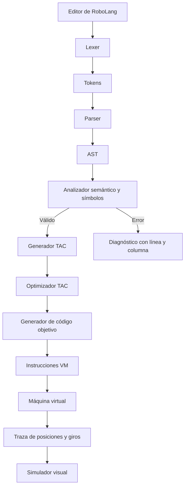

# RoboLang — Guía integral de construcción y sustentación

> **Asignatura:** Construcción de Compiladores  
> **Tipo de entrega:** Proyecto final individual o en equipo, según indique el docente  
> **Producto:** compilador educativo de un lenguaje propio + máquina virtual + simulador de robot en cuadrícula  
> **Estado de este documento:** especificación y plan de implementación. **No implica que la aplicación, las pruebas ni los resultados ya estén realizados.**  
> **Versión de la especificación:** 1.0 (MVP propuesto)

---

## Índice

1. [Resumen ejecutivo](#1-resumen-ejecutivo)
2. [Fundamento académico y criterios de sustentación](#2-fundamento-académico-y-criterios-de-sustentación)
3. [Problema, propósito y caso de uso](#3-problema-propósito-y-caso-de-uso)
4. [Alcance y prioridades](#4-alcance-y-prioridades)
5. [Experiencia de usuario e interfaz](#5-experiencia-de-usuario-e-interfaz)
6. [Especificación formal del lenguaje](#6-especificación-formal-del-lenguaje)
7. [Arquitectura y flujo de información](#7-arquitectura-y-flujo-de-información)
8. [Fase 1: análisis léxico](#8-fase-1-análisis-léxico)
9. [Fase 2: análisis sintáctico](#9-fase-2-análisis-sintáctico)
10. [Fase 3: análisis semántico](#10-fase-3-análisis-semántico)
11. [Fase 4: código intermedio TAC](#11-fase-4-código-intermedio-tac)
12. [Fase 5: optimización](#12-fase-5-optimización)
13. [Fase 6: código objetivo](#13-fase-6-código-objetivo)
14. [Máquina virtual, ejecución y simulación](#14-máquina-virtual-ejecución-y-simulación)
15. [Ejemplo integral verificable](#15-ejemplo-integral-verificable)
16. [Diagnósticos y casos de error](#16-diagnósticos-y-casos-de-error)
17. [Tecnologías y organización del repositorio](#17-tecnologías-y-organización-del-repositorio)
18. [API para la interfaz web](#18-api-para-la-interfaz-web)
19. [Plan paso a paso de desarrollo](#19-plan-paso-a-paso-de-desarrollo)
20. [Plan de pruebas y criterios de aceptación](#20-plan-de-pruebas-y-criterios-de-aceptación)
21. [Evidencias y preparación de la sustentación](#21-evidencias-y-preparación-de-la-sustentación)
22. [Preguntas posibles del docente](#22-preguntas-posibles-del-docente)
23. [Riesgos, límites y mejoras futuras](#23-riesgos-límites-y-mejoras-futuras)
24. [Checklist final y definición de terminado](#24-checklist-final-y-definición-de-terminado)
25. [Fuentes académicas y decisiones propias](#25-fuentes-académicas-y-decisiones-propias)

---

## 1. Resumen ejecutivo

**RoboLang** es una aplicación web educativa donde el usuario escribe un programa corto para mover y girar un robot virtual en una cuadrícula. Un compilador construido en Python transforma ese programa, en este orden, en **tokens → árbol de sintaxis abstracta (AST) → validación semántica → código intermedio TAC → TAC optimizado → código objetivo de una máquina virtual**. Una **máquina virtual ejecuta el código objetivo** y produce los movimientos que la interfaz anima.

### Objetivo general

Diseñar e implementar un compilador funcional para un lenguaje reducido de control de robot, explicando y demostrando las seis fases de compilación, el manejo de símbolos, tipos y ámbitos, la generación de instrucciones, los errores de compilación y la ejecución mediante una máquina virtual educativa.

### Objetivos específicos

1. Reconocer lexemas, tokens y coordenadas de código fuente.
2. Definir una gramática concreta y construir un parser que genere AST.
3. Verificar existencia, tipos, redeclaración, asignación y ámbito de variables.
4. Producir código de tres direcciones (TAC) en cuádruplas.
5. Aplicar al menos una optimización válida y demostrar su efecto sin cambiar el resultado.
6. Traducir TAC a instrucciones de una arquitectura virtual documentada.
7. Ejecutar esas instrucciones **sin ejecutar el texto fuente directamente** y visualizar el recorrido.
8. Mostrar errores precisos y disponer de pruebas repetibles y una demostración defendible.

### Alcance visual deseado

Editor de código a la izquierda, cuadrícula y robot a la derecha, y pestañas inferiores para tokens, AST, símbolos, TAC, optimización, ensamblador y consola. La interfaz es un medio para **hacer visible el compilador**, no la parte central de la evaluación.

---

## 2. Fundamento académico y criterios de sustentación

Las presentaciones del curso describen la progresión académica así:

| Tema del curso | Evidencia en RoboLang |
|---|---|
| Introducción y arquitectura | Diagrama de front-end, middle-end, back-end y máquina virtual. |
| Léxico: patrones, lexemas, tokens, autómatas | Lexer con tipos, valor, línea y columna; explicación de patrones y equivalencia conceptual con un DFA. |
| Sintaxis: BNF/EBNF, parser y AST | Gramática formal, descendente recursivo, precedencia de operadores y árbol visible. |
| Tabla de símbolos y ámbitos | Pila de ámbitos, búsqueda desde el ámbito actual al global, sombreado y errores de visibilidad. |
| Chequeo de tipos | Variables `entero` y `giro`, operadores compatibles e instrucciones tipadas. |
| IR y TAC | Cuádruplas con temporales, independientes de la máquina virtual. |
| Optimización | Plegado de constantes y comparación antes/después. |
| Memoria y registros | Slots de variables, slots temporales, registros `R0`/`R1`, alcance de memoria y explicación de stack/heap. |
| Código objetivo | Traductor TAC → instrucciones de máquina virtual. |

**Criterio explícito de la presentación de cierre (sesión del 6 de noviembre, página 17 del PDF):** demostrar el camino **Tokens → AST → TAC → Ensamblador**; reportar línea de errores léxicos, sintácticos y semánticos; explicar símbolos y memoria/registros; defender un programa correcto y uno con fallo semántico.

**Importante:** el documento del curso utiliza el término *ensamblador*. Aquí se generará **pseudoensamblador para una CPU virtual propia**, no código nativo x86/ARM. Hay que comunicarlo así, sin presentarlo como binario real.

---

## 3. Problema, propósito y caso de uso

### Necesidad que resuelve

Aprender compiladores puede ser abstracto: el estudiante ve definiciones de token, AST y TAC, pero no observa cómo esas representaciones provocan un efecto. RoboLang muestra cómo órdenes escritas en un pequeño lenguaje terminan moviendo un robot. Sirve como laboratorio docente, demostrador de compilación y herramienta de aprendizaje.

### Usuario

Un estudiante que conoce programación básica y desea experimentar con instrucciones, errores, variables, operaciones y ámbitos.

### Historia de usuario principal

> Como estudiante, quiero escribir un programa RoboLang, compilarlo y observar cada fase, para entender cómo se traduce mi código y comprobar que el robot hace lo que ordené.

### Historia secundaria

> Como estudiante, quiero recibir el tipo y la ubicación de un error para distinguir cuándo falla el lexer, el parser, el análisis semántico o la ejecución.

### Qué lo diferencia de una calculadora

Los cálculos son **parte del lenguaje**, pero su propósito concreto es producir órdenes `mover` y `girar`. El código objetivo **sí tiene un consumidor funcional**: la máquina virtual que controla el robot.

---

## 4. Alcance y prioridades

### Obligatorio para el MVP

- Editor de fuente y botón **Compilar**.
- Botón **Ejecutar** que solo se habilite tras compilar correctamente.
- Cuadrícula fija **8 × 8**, robot con posición y orientación.
- Declaraciones y asignaciones `entero` y `giro`.
- Operaciones enteras `+`, `-`, `*`, `-` unario y paréntesis.
- Instrucciones `mover(expresión);` y `girar(expresión);`.
- Bloques `{ ... }`, ámbitos anidados y sombreado.
- Lexer, parser, AST, análisis semántico, TAC, optimización y código objetivo.
- VM con registros `R0` y `R1`, memoria de variables y temporales.
- Diagnósticos con **fase, mensaje, línea y columna**.
- Ejemplos de éxito, error léxico, sintáctico, semántico y error de ejecución.
- Pruebas unitarias y una prueba extremo a extremo.

### Valioso, pero secundario

- Animación paso a paso con controles pausa/reiniciar.
- Mostrar instrucciones originales y optimizadas lado a lado.
- Resaltar instrucción actual y celda actual.
- Descargar resultados como JSON.
- Guardar programas de ejemplo localmente.

### Fuera del MVP (no añadir por rellenar)

- Robot físico, Arduino, ROS, conexión Bluetooth.
- Compilar Python, C, Java, JavaScript o ejecutables de CPU reales.
- Funciones, llamadas y recursión.
- Arreglos, objetos, memoria heap dinámica, recolector de basura.
- Algoritmo de optimización global o coloreado de grafos.
- Autenticación, base de datos, cuentas, trabajo multiusuario.
- Obstáculos dinámicos, sensores, búsqueda de caminos, mapas complejos.
- IA generativa, chat, servicios cloud o notificaciones.

**Regla de alcance:** no incorporar nada de la columna anterior antes de tener compilación y ejecución de punta a punta funcionando.

---

## 5. Experiencia de usuario e interfaz

### Pantalla única

```text
┌─────────────────────────────────────────────────────────────────────────┐
│ ROBOLANG                                     Ejemplos   Ayuda           │
├─────────────────────────────────────┬───────────────────────────────────┤
│ EDITOR DE CÓDIGO                    │ SIMULADOR 8×8                     │
│                                     │                                   │
│ entero pasos = 2 + 1;               │  · · · · · · · ·                    │
│ giro lado = derecha;                │  · · · · · · · ·                    │
│ mover(pasos);                       │  · · · · · · · ·                    │
│ girar(lado);                        │  · · · · · · · ·                    │
│ {                                   │  · ↑ · · · · · ·                    │
│   entero pasos = 2;                 │  · · · · · · · ·                    │
│   mover(pasos);                     │  · · · · · · · ·                    │
│ }                                   │  · · · · · · · ·                    │
│                                     │                                   │
│ [Compilar] [Ejecutar] [Paso] [Reset]│ Estado: listo                     │
├─────────────────────────────────────┴───────────────────────────────────┤
│ Tokens | AST | Símbolos | TAC | Optimización | Ensamblador | Consola     │
│ ...                                                                     │
└─────────────────────────────────────────────────────────────────────────┘
```

El dibujo es un **wireframe**, no la disposición exacta ni el estado final del robot.

### Diseño visual recomendado

- Fondo oscuro neutro; paneles con bordes suaves; tipografía legible.
- Colores consistentes: un color para acciones, verde para éxito, rojo para error.
- Editor monoespaciado con números de línea (si es posible).
- Cuadrícula con celdas cuadradas, robot representado con flecha o emoji y trayectoria visible.
- Pestañas que permitan inspeccionar las fases sin abrir varias ventanas.
- Botón **Compilar** separado de **Ejecutar** para enseñar la diferencia.
- En móviles, columnas apiladas; la sustentación se hace cómodamente en computador.

### Reglas de experiencia

1. Al editar el código, invalidar compilación y ejecución anteriores (evitar resultados desactualizados).
2. Mostrar «Compilación exitosa» solo si el pipeline terminó correctamente.
3. Ante error de compilación, **no ejecutar movimientos**.
4. Al ejecutar, reiniciar el estado del robot a la posición inicial determinista.
5. Permitir ver la traza de ejecución incluso después de terminar.
6. Mostrar claramente si un error ocurrió en compilación o ejecución.

---

## 6. Especificación formal del lenguaje

### 6.1 Convenciones y decisiones

- Nombre del lenguaje: **RoboLang 1.0**.
- Sensible a mayúsculas/minúsculas: `mover` es válido; `Mover` es identificador, no instrucción.
- Una instrucción termina con `;` excepto los bloques.
- Comentarios de una línea empiezan por `//`.
- Dos tipos de datos de usuario: **`entero`** (número entero) y **`giro`** (`derecha` o `izquierda`).
- `girar(derecha)` rota **90° a la derecha respecto a la orientación actual**. No establece orientación absoluta.
- No hay conversiones implícitas entre `entero` y `giro`.
- No hay operadores booleanos ni comparaciones en el MVP.
- Se permiten espacios y saltos de línea entre tokens.
- El punto de partida es **(columna=1, fila=4), orientado hacia arriba**, con índices desde cero en una cuadrícula 8×8.
- El eje `x` crece hacia la derecha; el eje `y` crece hacia abajo.

### 6.2 Gramática EBNF completa del MVP

```ebnf
programa     = { sentencia }, EOF ;
sentencia    = declaracion | asignacion | mover | girar | bloque ;
declaracion  = tipo, IDENT, "=", expresion, ";" ;
tipo         = "entero" | "giro" ;
asignacion   = IDENT, "=", expresion, ";" ;
mover        = "mover", "(", expresion, ")", ";" ;
girar        = "girar", "(", expresion, ")", ";" ;
bloque       = "{", { sentencia }, "}" ;
expresion    = suma ;
suma         = producto, { ("+" | "-"), producto } ;
producto     = unario, { "*", unario } ;
unario       = "-", unario | primario ;
primario     = ENTERO_LITERAL
             | "derecha" | "izquierda"
             | IDENT
             | "(", expresion, ")" ;
```

**Nota:** `IDENT`, `ENTERO_LITERAL` y `EOF` son categorías del lexer, no texto literal. Esta gramática permite expresiones bien formadas que podrían ser *semánticamente inválidas*: por ejemplo `2 + derecha`; corresponde al analizador semántico rechazarlas, no al parser.

### 6.3 Tokens

| Categoría | Patrón / criterio | Ejemplo |
|---|---|---|
| Palabras reservadas | Coincidencia exacta después de reconocer identificador | `entero`, `giro`, `mover`, `girar`, `derecha`, `izquierda` |
| `IDENT` | `[A-Za-z_][A-Za-z0-9_]*` | `pasos`, `mi_giro` |
| `ENTERO_LITERAL` | `[0-9]+` | `0`, `12`, `500` |
| `ASSIGN` | `=` | `=` |
| `PLUS` | `+` | `+` |
| `MINUS` | `-` | `-` |
| `STAR` | `*` | `*` |
| `LPAREN`, `RPAREN` | `(`, `)` | `(`, `)` |
| `LBRACE`, `RBRACE` | `{`, `}` | `{`, `}` |
| `SEMICOLON` | `;` | `;` |
| Espacios / comentarios | Saltar y actualizar posición | `// comentario` |
| `EOF` | Token final virtual | Fin de archivo |

Los identificadores se reconocen primero como palabra completa y luego se comparan con la tabla de palabras reservadas: esto impide dividir `mover2` en `mover` + `2`.

### 6.4 Ejemplos válidos

**A. Movimiento simple**

```robolang
mover(3);
girar(derecha);
mover(2);
```

**B. Variables, precedencia y giros**

```robolang
entero pasos = 2 + 3 * 2;
giro sentido = izquierda;
mover(pasos);
girar(sentido);
```

**C. Ámbito local y sombreado**

```robolang
entero pasos = 3;
mover(pasos);
{
    entero pasos = 2;
    mover(pasos);
}
mover(pasos);
```

Después de salir del bloque, el último `mover(pasos)` vuelve a utilizar la variable externa.

### 6.5 Ejemplos no válidos

```robolang
mover(@);            // léxico: símbolo no reconocido
mover(3;            // sintáctico: falta ')'
mover(derecha);      // semántico: mover requiere entero
entero x = 2;
entero x = 5;        // semántico: redeclaración en mismo ámbito
mover(no_existe);    // semántico: variable no declarada
```

**No confundir:** `mover(20);` puede compilar correctamente (tipo entero válido) y producir **error de ejecución** cuando el robot intenta abandonar el tablero.

---

## 7. Arquitectura y flujo de información



### Responsabilidades separadas

| Módulo | Entrada | Salida | No debe hacer |
|---|---|---|---|
| Lexer | Texto fuente | Lista de tokens | Validar tipos o mover robot |
| Parser | Tokens | AST | Acceder a la cuadrícula |
| Semántico | AST | AST anotado + símbolos / diagnósticos | Ejecutar movimientos |
| Generador TAC | AST semánticamente válido | Cuádruplas | Dibujar robot |
| Optimizador | TAC | TAC equivalente | Alterar resultados observables |
| Codegen | TAC | Instrucciones de VM | Ejecutar código fuente |
| VM | Instrucciones de VM | Estados, traza, errores runtime | Volver a interpretar texto RoboLang |
| UI | Fuente + resultados + traza | Visualización | Implementar reglas del compilador duplicadas |

**Regla arquitectónica indispensable:** el simulador no lee directamente `mover(3)` del texto del usuario. Debe reproducir eventos generados por la **ejecución de código objeto en la VM**. De lo contrario, las fases serían solo decorativas.

### Contratos internos propuestos

```python
@dataclass(frozen=True)
class Token:
    type: str
    lexeme: str
    line: int
    column: int

@dataclass(frozen=True)
class Diagnostic:
    phase: str        # lexical | syntax | semantic | runtime
    code: str         # ejemplo SEM_UNDECLARED
    message: str
    line: int
    column: int
```

```python
def tokenize(source: str) -> list[Token]: ...
def parse(tokens: list[Token]) -> ProgramNode: ...
def analyze(ast: ProgramNode) -> SemanticResult: ...
def generate_tac(ast: ProgramNode, symbols: list) -> list[Quad]: ...
def optimize(tac: list[Quad]) -> list[Quad]: ...
def generate_vm_code(tac: list[Quad]) -> list[Instruction]: ...
def execute(code: list[Instruction], config: RobotConfig) -> ExecutionResult: ...
```

La interfaz de compilación debería devolver todas las representaciones incluso en formato serializable (`dict`/JSON) para poder mostrarlas.

---

## 8. Fase 1: análisis léxico

### Objetivo

Recorrer el archivo de izquierda a derecha, formar tokens y descartar espacios/comentarios sin perder las coordenadas originales.

### Implementación sencilla

1. Mantener índice de carácter, `line=1`, `column=1`.
2. Detectar espacios y saltos de línea (actualizar coordenadas).
3. Si aparece `//`, ignorar hasta terminar la línea.
4. Reconocer identificadores completos y comprobar si son reservados.
5. Reconocer dígitos consecutivos como literal entero.
6. Reconocer símbolos individuales (`=`, `+`, `-`, `*`, `(`, `)`, `{`, `}`, `;`).
7. Si un carácter no coincide, emitir diagnóstico léxico con posición exacta.
8. Al terminar, agregar token `EOF`.

### Ejemplo de tokenización

Fuente:

```robolang
entero pasos = 2 + 1;
mover(pasos);
```

Fragmento de salida:

| Tipo | Lexema | Línea | Columna |
|---|---|---:|---:|
| `KW_ENTERO` | `entero` | 1 | 1 |
| `IDENT` | `pasos` | 1 | 8 |
| `ASSIGN` | `=` | 1 | 14 |
| `INT` | `2` | 1 | 16 |
| `PLUS` | `+` | 1 | 18 |
| `INT` | `1` | 1 | 20 |
| `SEMICOLON` | `;` | 1 | 21 |
| `KW_MOVER` | `mover` | 2 | 1 |
| ... | ... | ... | ... |

### Prueba mínima

```python
def test_lexer_reconoce_inicio_de_declaracion():
    tokens = tokenize("entero pasos = 2;")
    assert [t.type for t in tokens[:4]] == [
        "KW_ENTERO", "IDENT", "ASSIGN", "INT"
    ]
```

**Cómo explicarlo:** lexema = texto encontrado (`pasos`); token = su categoría (`IDENT`); patrón = regla que permite reconocerlo. NFA/DFA son modelos formales de reconocimiento; **no afirmar que construiste un DFA manual** si usaste expresiones regulares o un escáner por condiciones.

---

## 9. Fase 2: análisis sintáctico

### Técnica elegida

**Parser descendente recursivo**. Es apropiado porque la gramática es reducida y permite explicar directamente qué función implementa cada regla.

```text
parse_program()
parse_statement()
parse_declaration()
parse_assignment()
parse_move()
parse_turn()
parse_block()
parse_expression() -> parse_additive()
parse_additive() -> parse_multiplicative()
parse_multiplicative() -> parse_unary()
parse_unary() -> parse_primary()
```

### Nodos AST que se deben representar

```text
Program(statements)
Block(statements)
VarDeclaration(name, declared_type, expression, location)
Assignment(name, expression, location)
Move(expression, location)
Turn(expression, location)
BinaryOperation(operator, left, right, location)
UnaryOperation(operator, operand, location)
IntLiteral(value, location)
TurnLiteral(value, location)
VariableReference(name, location)
```

### Por qué importa la precedencia

Para `2 + 3 * 4`, el parser debe producir:

```text
BinaryOperation(+)
├── IntLiteral(2)
└── BinaryOperation(*)
    ├── IntLiteral(3)
    └── IntLiteral(4)
```

**No** construir `(2 + 3) * 4`. La jerarquía sale de `producto` antes de `suma`, no de evaluar la cadena con `eval()`.

### Reglas importantes del parser

- `expect(type)` consume el token esperado o genera un diagnóstico sintáctico.
- No permitir tokens sobrantes silenciosos después de terminar una sentencia.
- Permitir múltiples sentencias dentro de `{ ... }`.
- Al detectar error, informar la posición del token conflictivo; para un símbolo ausente al final de línea, usar la posición actual o EOF y describir lo esperado.
- No hacer comprobaciones de tipos aquí: `mover(derecha);` es sintácticamente correcto.

### Prueba clave

```python
def test_precedencia():
    ast = parse(tokenize("entero x = 2 + 3 * 4;"))
    expr = ast.statements[0].expression
    assert expr.operator == "+"
    assert expr.right.operator == "*"
```

---

## 10. Fase 3: análisis semántico

### Responsabilidad

Recorre el AST y comprueba reglas del lenguaje que la gramática no puede garantizar: identificadores declarados, tipos adecuados, visibilidad por bloque y compatibilidad entre expresiones e instrucciones.

### Tipos de RoboLang

| Tipo | Valores | Operaciones admitidas |
|---|---|---|
| `entero` | Enteros con signo | `+`, `-`, `*`, `-` unario |
| `giro` | `derecha`, `izquierda` | Asignación y paso a `girar(...)` |

Reglas:

- `entero x = 1 + 2;` → correcto.
- `giro g = izquierda;` → correcto.
- `entero x = derecha;` → error de tipos.
- `giro g = 1;` → error de tipos.
- `entero x = 2 + derecha;` → error de tipos en suma.
- `mover(exp)` requiere `exp : entero`.
- `girar(exp)` requiere `exp : giro`.
- `x = exp;` requiere `tipo(exp) == tipo(x)`.
- Usar un identificador no declarado → error semántico.
- Declarar el mismo nombre dos veces **en el mismo ámbito** → error semántico.
- Se permite declarar el mismo nombre en un bloque hijo (*shadowing*, sombreado), si lo documentamos y probamos.

### Tabla de símbolos

Propuesta de estructura:

| Campo | Significado | Ejemplo |
|---|---|---|
| `name` | Nombre fuente | `pasos` |
| `type` | Tipo | `entero` |
| `scope_id` | Identificador del bloque | `global`, `bloque_1` |
| `slot` | Dirección virtual única | `S0`, `S2` |
| `decl_line`, `decl_col` | Ubicación de declaración | `1`, `8` |

### Pila de ámbitos

```python
scopes = [global_scope]

def enter_scope():
    scopes.append({})

def lookup(name):
    for scope in reversed(scopes):
        if name in scope:
            return scope[name]
    return None

def define_current(name, symbol):
    if name in scopes[-1]:
        raise SemanticError("Redeclaración en el mismo ámbito")
    scopes[-1][name] = symbol

def exit_scope():
    scopes.pop()
```

Cada símbolo tiene un slot virtual **único**, incluso si se llama igual que otro símbolo en otro bloque. Así:

```robolang
entero pasos = 3;  // S0, global
{
    entero pasos = 2; // S1, local
    mover(pasos);     // resuelve S1
}
mover(pasos);         // resuelve S0
```

**Importante:** al salir de un bloque, la tabla elimina su visibilidad semántica. La VM puede usar slots estáticos para la memoria; eso **no significa** que se implementaran llamadas de función ni stack frames reales.

### Algoritmo de tipos (conceptual)

```python
def infer_type(expr, symbol_table):
    if isinstance(expr, IntLiteral):
        return "entero"
    if isinstance(expr, TurnLiteral):
        return "giro"
    if isinstance(expr, VariableReference):
        symbol = symbol_table.lookup(expr.name)
        if symbol is None:
            raise SemanticError("Variable no declarada", expr.location)
        expr.resolved_slot = symbol.slot
        return symbol.type
    if isinstance(expr, UnaryOperation):
        if infer_type(expr.operand, symbol_table) != "entero":
            raise SemanticError("Negación requiere entero", expr.location)
        return "entero"
    if isinstance(expr, BinaryOperation):
        left = infer_type(expr.left, symbol_table)
        right = infer_type(expr.right, symbol_table)
        if left != "entero" or right != "entero":
            raise SemanticError("Operación aritmética requiere enteros", expr.location)
        return "entero"
```

El código es **referencia de algoritmo**, no implementación lista para ejecutar sin definir clases, excepciones y estructura de ámbitos.

### Qué se comprueba en compilación y qué en ejecución

- **Compilación:** existe la variable, tipo de argumento válido, operaciones compatibles, sintaxis correcta.
- **Ejecución:** el movimiento real no abandona el tablero y no se superan límites de recursos. Por simplicidad, valores como `mover(-2)` también se rechazan en ejecución, aunque eventualmente podrían detectarse antes mediante análisis de constantes.

---

## 11. Fase 4: código intermedio TAC

### Propósito

Convertir el AST en una secuencia lineal y relativamente independiente de la arquitectura final. La representación elegida es una lista de **cuádruplas**:

```python
@dataclass(frozen=True)
class Quad:
    op: str
    arg1: object | None
    arg2: object | None
    result: object | None
    line: int
```

Una cuádrupla usa operador, argumento 1, argumento 2 y resultado (más la línea como metadato de diagnóstico).

### Formato de operandos

No usar cadenas ambiguas: definir operandos tipados:

```text
ImmInt(3)      valor numérico inmediato
ImmTurn(RIGHT) giro inmediato
Slot(S0)       variable de usuario, resuelta semánticamente
Temp(T0)       temporal de código intermedio
```

### Operaciones TAC del MVP

| Operación TAC | Significado | Ejemplo |
|---|---|---|
| `ADD a b -> t` | suma de enteros | `ADD 2 1 -> T0` |
| `SUB a b -> t` | resta | `SUB S0 1 -> T1` |
| `MUL a b -> t` | producto | `MUL S0 2 -> T2` |
| `NEG a -> t` | negación | `NEG S0 -> T3` |
| `COPY a -> s` | asignación a slot | `COPY T0 -> S0` |
| `MOVE a` | orden de desplazamiento | `MOVE S0` |
| `TURN a` | orden de giro | `TURN RIGHT` |

### Ejemplo

Fuente:

```robolang
entero pasos = 2 + 1;
mover(pasos);
```

TAC inicial:

```text
T0 = 2 + 1
S0 = T0
MOVE S0
```

Cuádruplas equivalentes:

```text
(ADD,  ImmInt(2), ImmInt(1), Temp(T0))
(COPY, Temp(T0),  None,      Slot(S0))
(MOVE, Slot(S0),  None,      None)
```

**Aclaración de vocabulario:** la frase “código de tres direcciones” no significa que todas las instrucciones tengan exactamente tres operandos; significa que una operación binaria usa como máximo dos entradas y un destino. `MOVE S0` también puede ser una instrucción válida de la IR extendida.

### Generación del TAC

- Un literal devuelve `ImmInt` o `ImmTurn`, sin necesidad de una instrucción.
- Una referencia resuelta devuelve `Slot(Sn)`.
- Una operación binaria genera TAC para sus hijos y luego un temporal `Tn`.
- Una declaración/asignación emite `COPY` hacia el slot resuelto.
- `mover()` y `girar()` emiten `MOVE`/`TURN` después de generar su expresión.
- Un bloque genera TAC para sus sentencias en orden, preservando los slots ya resueltos.

No generar TAC si la fase semántica falló.

---

## 12. Fase 5: optimización

### Optimización mínima: plegado de constantes

Si una operación usa constantes enteras conocidas, reemplazarla por su resultado:

```text
ANTES:    T0 = 2 + 1
DESPUÉS:  T0 = 3
```

Formalmente:

```text
ADD ImmInt(a) ImmInt(b) -> Temp(t)
se transforma en
COPY ImmInt(a+b) -> Temp(t)
```

Y lo mismo para `SUB`, `MUL`, `NEG` con operandos constantes.

### Criterios de seguridad

- Optimizar **después** del análisis semántico.
- No eliminar ni reordenar `MOVE` ni `TURN`, porque tienen efectos observables.
- No cambiar tipos.
- Respetar la semántica elegida para enteros (ver §14: enteros Python con límite práctico de entrada, sin overflow de CPU física).
- Si no se implementa propagación de constantes entre variables, decirlo explícitamente.
- Mantener disponible una vista **sin optimizar** para comparar resultados.

### Verificación de equivalencia

Compilar el mismo programa con optimización encendida/apagada; ejecutar ambas versiones en la VM desde el mismo estado inicial y comparar:

1. Posición final.
2. Orientación final.
3. Secuencia de eventos observables del robot.
4. Errores de ejecución, cuando aplique.

**No basta** con que el TAC tenga menos líneas; debe preservar la semántica.

### Optimizaciones futuras opcionales

Simplificación `x + 0 → x`, propagación de constantes, eliminación de temporales no usados. **No implementar estas como requisito del MVP**.

---

## 13. Fase 6: código objetivo

### Arquitectura virtual diseñada para RoboLang

La máquina virtual tiene:

- Dos registros de propósito general: `R0`, `R1`.
- Memoria de slots de usuario: `S0`, `S1`, ...
- Memoria de temporales: `T0`, `T1`, ...
- Contador de programa `PC`.
- Estado del robot: `x`, `y`, `orientacion`.
- Una lista de instrucciones tipadas, presentadas como pseudoensamblador legible.

**El pseudoensamblador es el código objetivo**, no un dibujo de la fase; la VM lo ejecuta instrucción por instrucción.

### Instrucciones VM mínimas

| Instrucción | Significado |
|---|---|
| `LOADC R0, 3` | Carga entero o giro inmediato tipado en registro. |
| `LOAD R0, S0` | Lee un slot de memoria y carga su valor en `R0`. |
| `STORE S0, R0` | Guarda `R0` en slot. |
| `ADD R0, R1` | Reemplaza `R0` por `R0 + R1`. |
| `SUB R0, R1` | Reemplaza `R0` por `R0 - R1`. |
| `MUL R0, R1` | Reemplaza `R0` por `R0 * R1`. |
| `NEG R0` | Reemplaza `R0` por `-R0`. |
| `MOVE R0` | Desplaza el robot `R0` celdas. |
| `TURN R0` | Gira 90° según `R0` (`RIGHT`/`LEFT`). |
| `HALT` | Termina el programa. |

En almacenamiento interno, conviene que las instrucciones sean objetos `Instruction(opcode, args, line)`, **no cadenas que haya que analizar por segunda vez**. La UI puede mostrar una versión textual.

### Traducción determinista desde TAC

Regla general para una operación `ADD a b -> t`:

```text
LOAD_OPERAND R0, a  # se emite LOADC si a es inmediato; LOAD si es slot/temp
LOAD_OPERAND R1, b
ADD R0, R1
STORE t, R0
```

Para `COPY a -> s`:

```text
LOAD_OPERAND R0, a
STORE s, R0
```

Para `MOVE a`:

```text
LOAD_OPERAND R0, a
MOVE R0
```

Para `TURN a`:

```text
LOAD_OPERAND R0, a
TURN R0
```

Al final: `HALT`.

### Registros y memoria: qué afirmar correctamente

Este backend inicial utiliza **dos registros reutilizables** y guarda los temporales en slots de memoria. Es una estrategia simple y fácil de defender, aunque no es un asignador global óptimo de registros.

El curso también estudia **spill** (desbordamiento de registros a memoria). Si se desea demostrarlo de forma implementada, la **extensión opcional** sería mantener temporales vivos en registros y emitir `STORE` cuando todos estén ocupados, para luego recuperar con `LOAD`. **No afirmar que hay spill dinámico si solo guardamos todos los resultados temporalmente por diseño.**

Para la sustentación mínima basta explicar fielmente:

- La tabla de símbolos resuelve `pasos` a `S0`.
- `R0` y `R1` cargan operandos para una instrucción.
- El resultado se guarda en un slot temporal o de variable.
- La VM utiliza esos valores para ejecutar movimiento y giro.
- Un stack frame real pertenecería a la implementación de llamadas a funciones, que no existen en el MVP.
- El heap tampoco es necesario porque no se permiten estructuras dinámicas.

---

## 14. Máquina virtual, ejecución y simulación

### 14.1 Reglas del mundo

- Tamaño: 8 columnas × 8 filas.
- `x` válido entre `0` y `7`, `y` válido entre `0` y `7`.
- Estado inicial: `(x=1, y=4, orientacion=NORTE)`.
- Direcciones absolutas internas: `NORTE`, `ESTE`, `SUR`, `OESTE`.
- `girar(derecha)` rota `NORTE → ESTE → SUR → OESTE → NORTE`.
- `girar(izquierda)` rota en sentido contrario.
- `mover(0)` es válido y no cambia posición.
- `mover(n)` con `n < 0` produce error de ejecución.
- Si un movimiento intenta abandonar el tablero, se detiene en la última celda válida y produce error de ejecución. **No se mueve fuera del mapa**.
- Límite de seguridad propuesto: como máximo 200 desplazamientos elementales por ejecución, 2.000 instrucciones VM y 4.000 caracteres de fuente; valores configurables.
- No hay obstáculos en el MVP.

### 14.2 Algoritmo de giro

```python
ORIENTATIONS = ["NORTE", "ESTE", "SUR", "OESTE"]

def rotate(current: str, turn: str) -> str:
    i = ORIENTATIONS.index(current)
    if turn == "RIGHT":
        return ORIENTATIONS[(i + 1) % 4]
    if turn == "LEFT":
        return ORIENTATIONS[(i - 1) % 4]
    raise RuntimeError("Giro inválido")
```

### 14.3 Algoritmo de movimiento

```python
DELTA = {
    "NORTE": (0, -1),
    "ESTE":  (1, 0),
    "SUR":  (0, 1),
    "OESTE": (-1, 0),
}

def move_robot(state, steps):
    if not isinstance(steps, int) or isinstance(steps, bool) or steps < 0:
        raise RobotRuntimeError("El movimiento requiere entero no negativo")
    for _ in range(steps):
        dx, dy = DELTA[state.orientation]
        nx, ny = state.x + dx, state.y + dy
        if not (0 <= nx < 8 and 0 <= ny < 8):
            raise RobotRuntimeError("Movimiento fuera del tablero")
        state.x, state.y = nx, ny
        state.trace.append(snapshot(state))
```

**Nota:** se trata de pseudocódigo Python ilustrativo. `RobotRuntimeError`, `state`, `snapshot` y límites globales deben definirse en el proyecto.

### 14.4 Modelo de ejecución

```python
@dataclass
class RobotState:
    x: int = 1
    y: int = 4
    orientation: str = "NORTE"

@dataclass
class ExecutionEvent:
    pc: int
    source_line: int
    action: str         # move-step | turn | halt | error
    x: int
    y: int
    orientation: str
```

La VM recibe `list[Instruction]`, ejecuta secuencialmente con `PC`, lee y escribe memoria, modifica `RobotState` y registra eventos. La UI **solo anima `ExecutionEvent`**, con control de pasos.

### 14.5 Errores de runtime y límites

- Intentar salir del tablero: error y traza parcial.
- Valor negativo en `MOVE`: error.
- Exceso de instrucciones/movimientos: error controlado.
- Opcode o acceso a slot desconocido: error interno de VM; nunca entregar traceback crudo al usuario.
- Programa vacío: compila y ejecuta `HALT` sin movimiento; esto es válido y debe probarse.

### 14.6 Separación de fases

- **Compilar**: recibe fuente, devuelve representaciones y diagnósticos. **No cambia el robot**.
- **Ejecutar**: usa el código objetivo recién generado; reinicia el estado inicial y produce traza.
- **Reproducir**: el frontend anima la traza. Detener o pausar la animación no vuelve a compilar.

---

## 15. Ejemplo integral verificable

### Fuente de ejemplo para la demostración

```robolang
entero pasos = 2 + 1;
giro lado = derecha;
mover(pasos);
girar(lado);
{
    entero pasos = 2;
    mover(pasos);
}
```

### 15.1 Análisis léxico

- Se reconocen `entero`, `giro`, `mover`, `girar`, `derecha`, identificadores, números, operadores y delimitadores.
- El lexer guarda líneas y columnas.

### 15.2 AST abreviado

```text
Program
├── Declaration(entero, pasos)
│   └── Add(Int(2), Int(1))
├── Declaration(giro, lado)
│   └── TurnLiteral(derecha)
├── Move(Variable(pasos))
├── Turn(Variable(lado))
└── Block
    ├── Declaration(entero, pasos)
    │   └── Int(2)
    └── Move(Variable(pasos))
```

### 15.3 Tabla de símbolos

| Nombre | Tipo | Ámbito | Slot |
|---|---|---|---|
| `pasos` | `entero` | global | `S0` |
| `lado` | `giro` | global | `S1` |
| `pasos` | `entero` | bloque_1 | `S2` |

La tabla mostrada es un **registro de símbolos recopilados durante el análisis**, que incluye el símbolo local aunque el scope ya se haya cerrado. La búsqueda activa de símbolos, en cambio, respeta la pila de ámbitos vigente.

### 15.4 TAC antes de optimizar

```text
T0 = 2 + 1
S0 = T0
S1 = RIGHT
MOVE S0
TURN S1
S2 = 2
MOVE S2
```

### 15.5 TAC después de plegar constantes

```text
T0 = 3
S0 = T0
S1 = RIGHT
MOVE S0
TURN S1
S2 = 2
MOVE S2
```

Aquí `T0 = 3` es notación legible de `COPY ImmInt(3) -> Temp(T0)`. **No se está afirmando propagación de constantes entre `S0` y `MOVE`**, pues esa optimización queda fuera del MVP.

### 15.6 Pseudoensamblador propuesto (versión optimizada)

```asm
LOADC R0, 3
STORE T0, R0
LOAD R0, T0
STORE S0, R0
LOADC R0, RIGHT
STORE S1, R0
LOAD R0, S0
MOVE R0
LOAD R0, S1
TURN R0
LOADC R0, 2
STORE S2, R0
LOAD R0, S2
MOVE R0
HALT
```

Esta secuencia debe ser generada por `codegen.py` a partir del TAC; no dejarla fija como texto preprogramado.

### 15.7 Ejecución esperada

| Momento | Posición | Orientación |
|---|---|---|
| Inicio | `(1,4)` | NORTE |
| `mover(3)` | `(1,1)` | NORTE |
| `girar(derecha)` | `(1,1)` | ESTE |
| Bloque: `mover(2)` | `(3,1)` | ESTE |

**Resultado esperado:** termina en **(3,1)** apuntando **ESTE**, sin errores. El robot recorrió cinco celdas en total.

### 15.8 Demostración semántica contrastante

```robolang
entero pasos = 3;
giro lado = izquierda;
mover(lado);  // incorrecto: mover requiere entero
```

Salida esperada (texto propuesto):

```text
SEMANTIC ERROR [SEM_TYPE_MISMATCH]
Línea 3, columna 1: mover(...) espera entero, pero recibió giro.
No se generó código objetivo. No se ejecutó el robot.
```

---

## 16. Diagnósticos y casos de error

### Formato único

```json
{
  "phase": "semantic",
  "code": "SEM_TYPE_MISMATCH",
  "message": "mover(...) requiere entero, recibió giro",
  "line": 3,
  "column": 1
}
```

### Taxonomía

| Fase | Código sugerido | Programa / causa | Resultado |
|---|---|---|---|
| Léxica | `LEX_UNKNOWN_CHAR` | `mover(@);` | Rechazar `@` con posición. |
| Sintáctica | `SYN_EXPECTED_TOKEN` | `mover(3;` | Esperaba `)`. |
| Sintáctica | `SYN_EXPECTED_TOKEN` | `entero x = 3` | Esperaba `;`. |
| Sintáctica | `SYN_UNEXPECTED_TOKEN` | `mover();` | Falta expresión. |
| Semántica | `SEM_UNDECLARED` | `mover(pasos);` sin declarar | Variable inexistente. |
| Semántica | `SEM_REDECLARATION` | `entero x=1; entero x=2;` | Declaración repetida en mismo bloque. |
| Semántica | `SEM_TYPE_MISMATCH` | `mover(derecha);` | Se esperaba entero. |
| Semántica | `SEM_TYPE_MISMATCH` | `girar(3);` | Se esperaba giro. |
| Semántica | `SEM_TYPE_MISMATCH` | `entero x = 2 + derecha;` | Operación aritmética incompatible. |
| Semántica | `SEM_OUT_OF_SCOPE` (o `SEM_UNDECLARED`) | Uso de variable local fuera del bloque | No visible. |
| Ejecución | `RUN_OUT_OF_BOUNDS` | `mover(20);` | No abandonar cuadrícula. |
| Ejecución | `RUN_NEGATIVE_STEPS` | `mover(-1);` | No aceptar pasos negativos. |
| Ejecución | `RUN_LIMIT_EXCEEDED` | Excede límites | Detención controlada. |

### Política del MVP ante errores

- Empezar por reportar el **primer error** con precisión y recuperar interfaz sin caída.
- Si sobra tiempo, implementar acumulación de múltiples errores semánticos.
- No intentar recuperar y ejecutar programas semánticamente inválidos.
- Evitar mensajes como `IndexError`, `KeyError`, `Traceback` al usuario final.
- Guardar líneas y columnas desde lexer hasta AST/IR para diagnóstico completo.

---

## 17. Tecnologías y organización del repositorio

### Elección principal

| Capa | Propuesta | Motivo |
|---|---|---|
| Compilador | Python 3.11+ estándar (`dataclasses`, `enum`, `re`, `typing`) | Fácil de explicar, no requiere generador de parsers. |
| API web | FastAPI + Uvicorn | API mínima entre frontend y compilador. |
| Interfaz | HTML + CSS + JavaScript | Diseño cuidado sin framework frontend pesado. |
| Pruebas | Pytest | Validar cada fase y ejemplos integrales. |
| Versionamiento | Git y GitHub | Evidencia de desarrollo y cambios. |
| Editor | VS Code | Entorno familiar. |

**Por qué no usar PLY/ANTLR de entrada:** son válidos, pero el parser recursivo propio deja más visible cómo funciona la gramática; el enfoque se alinea con los laboratorios del curso. **Por qué no usar React y bases de datos:** aumentarían la carga de trabajo sin aportar a las seis fases.

### Estructura recomendada

```text
robolang/
├── README.md
├── requirements.txt
├── .gitignore
├── docs/
│   ├── lenguaje.md
│   ├── arquitectura.md
│   ├── pruebas.md
│   └── sustentacion.md
├── examples/
│   ├── 01_basico.rbl
│   ├── 02_variables.rbl
│   ├── 03_scopes.rbl
│   ├── 04_error_lexico.rbl
│   ├── 05_error_sintaxis.rbl
│   ├── 06_error_semantico.rbl
│   └── 07_error_runtime.rbl
├── robolang/
│   ├── __init__.py
│   ├── tokens.py
│   ├── lexer.py
│   ├── ast_nodes.py
│   ├── parser.py
│   ├── symbols.py
│   ├── semantic.py
│   ├── tac.py
│   ├── optimizer.py
│   ├── codegen.py
│   ├── vm.py
│   ├── diagnostics.py
│   └── compiler.py
├── web/
│   ├── __init__.py
│   ├── app.py
│   ├── static/
│   │   ├── index.html
│   │   ├── styles.css
│   │   └── app.js
├── tests/
│   ├── test_lexer.py
│   ├── test_parser.py
│   ├── test_semantic.py
│   ├── test_scopes.py
│   ├── test_tac.py
│   ├── test_optimizer.py
│   ├── test_codegen_vm.py
│   └── test_end_to_end.py
└── scripts/
    └── demo_cli.py
```

### Comandos iniciales (ejemplo)

```bash
mkdir robolang
cd robolang
python -m venv .venv
```

Activación del entorno:

```powershell
# Windows PowerShell
.\.venv\Scripts\Activate.ps1
```

```bash
# Linux/macOS
source .venv/bin/activate
```

`requirements.txt` mínimo:

```text
fastapi
uvicorn[standard]
pytest
httpx
```

Instalación y ejecución:

```bash
python -m pip install -r requirements.txt
python -m pytest -q
uvicorn web.app:app --reload
```

La interfaz puede servirse con FastAPI como archivo estático; abrir `http://127.0.0.1:8000/`. Para una entrega reproducible, fijar versiones comprobadas en `requirements.txt` o un lockfile tras verificar compatibilidad.

---

## 18. API para la interfaz web

### `POST /api/compile`

Recibe:

```json
{
  "source": "entero pasos = 2 + 1; mover(pasos);",
  "optimize": true
}
```

Respuesta correcta (estructura **ilustrativa**, no una captura real):

```json
{
  "ok": true,
  "tokens": [{"type": "KW_ENTERO", "lexeme": "entero", "line": 1, "column": 1}],
  "ast": {"node": "Program", "children": []},
  "symbols": [{"name": "pasos", "type": "entero", "scope": "global", "slot": "S0"}],
  "tac_before": ["T0 = 2 + 1", "S0 = T0", "MOVE S0"],
  "tac_after": ["T0 = 3", "S0 = T0", "MOVE S0"],
  "assembly": ["LOADC R0, 3", "STORE T0, R0", "...", "HALT"],
  "diagnostics": []
}
```

Los arreglos resumidos (`...`, AST vacío) solo ilustran el contrato; la implementación real debe devolver contenido completo. Para fallos léxicos, sintácticos y semánticos, devolver `ok: false`, diagnóstico y un HTTP 400 o 422 según la convención API acordada, sin tratar un error legítimo del usuario como error 500.

### `POST /api/run`

Recibe `source` y `optimize`, llama a la **misma función compiladora** y, si `ok`, ejecuta el código VM; devuelve la compilación junto con:

```json
{
  "execution": {
    "ok": true,
    "start": {"x": 1, "y": 4, "orientation": "NORTE"},
    "final": {"x": 1, "y": 1, "orientation": "NORTE"},
    "events": [
      {"pc": 5, "source_line": 1, "action": "move-step", "x": 1, "y": 3, "orientation": "NORTE"}
    ]
  }
}
```

Para error runtime: `execution.ok=false`, conservar `events` válidos anteriores y anexar diagnóstico `phase="runtime"`. El frontend **reproduce** esos eventos con un intervalo visual; si se detiene la animación, solo cambia la reproducción de la traza, no la compilación.

### Medidas básicas

- Limitar tamaño de entrada e instrucciones ejecutadas.
- Validar tipo de `source` y `optimize`.
- No ejecutar `eval`, `exec`, scripts de shell ni Python recibido del usuario.
- No aceptar instrucciones VM arbitrarias desde el navegador: solo ejecuta código generado por el compilador.
- Tratar errores de usuario y fallos internos por separado.

---

## 19. Plan paso a paso de desarrollo

Cada fase se completa **antes** de avanzar; esto reduce el riesgo de tener una interfaz bonita conectada a un compilador incompleto.

### Hito 0. Base del proyecto

**Tareas:** repositorio Git, carpetas, Python, Pytest, ejemplos, README inicial.  
**Comprobación:** `pytest` ejecuta una prueba de humo y el proyecto inicia sin errores de importación.

### Hito 1. Lenguaje y lexer

**Tareas:** escribir `docs/lenguaje.md`; implementar tokens con posiciones, palabras reservadas, comentarios, errores.  
**Comprobación:** salida de tokens esperada para ejemplos válidos y diagnóstico exacto para `@`.

### Hito 2. Parser y AST

**Tareas:** clases AST; parser descendente; precedencia, bloques, sentencias, ubicación de errores.  
**Comprobación:** AST correcto para `2 + 3 * 4`, y error de `)` faltante.

### Hito 3. Semántica y ámbitos

**Tareas:** tabla de símbolos y pila de scopes; `entero`, `giro`; validación de tipos; slots resueltos.  
**Comprobación:** compila `mover(pasos)` declarado, rechaza variable no declarada y uso local fuera del bloque.

### Hito 4. TAC y optimización

**Tareas:** generar cuádruplas tipadas; temporales; conservar líneas; fold de constantes.  
**Comprobación:** `2 + 1` produce `T0 = 2 + 1`, y optimizado `T0 = 3`.

### Hito 5. Backend y VM (hito crítico)

**Tareas:** `Instruction`, traductor de TAC, `R0`/`R1`, slots, contador `PC`, `MOVE`, `TURN`, traza.  
**Comprobación:** el ejemplo integral termina en `(3,1)` orientado ESTE y el simulador no usa el texto fuente directamente.

### Hito 6. Integración real de fases

**Tareas:** `compiler.py` orquesta; compilación fallida impide VM; ejecutar con optimización activada/desactivada.  
**Comprobación:** comparar trazas; verificar mensajes de error por fase; programa vacío termina con `HALT`.

### Hito 7. Interfaz web

**Tareas:** FastAPI, editor, panel de cuadrícula, tabs y animación de traza.  
**Comprobación:** al cambiar el código se invalidan resultados viejos; `Compilar` no mueve robot; `Ejecutar` anima ejecución.

### Hito 8. Pruebas, documentación y sustentación

**Tareas:** terminar suite; capturas y ejemplos; README; diagrama; pruebas con/sin optimización; guion.  
**Comprobación:** checklist final completo, demo reproducible en equipo del salón.

### Orden de prioridad si hay poco tiempo

1. **Pipeline funcional CLI completo**, con fases y errores.
2. **VM ejecutando código objetivo**.
3. **Interfaz básica con animación y pestañas**.
4. Mejoras visuales, optimizaciones extra, descargables.

No sacrificar el generador de código o semántica para dedicar más tiempo a CSS.

---

## 20. Plan de pruebas y criterios de aceptación

Las siguientes pruebas son una **matriz propuesta**, no resultados obtenidos. Usar Pytest y separar los tests por fases.

### 20.1 Pruebas del lexer

| ID | Entrada / situación | Esperado |
|---|---|---|
| L01 | `mover(3);` | Tokens correctos más EOF. |
| L02 | `mover2` | Un `IDENT`, no la palabra reservada `mover`. |
| L03 | Espacios y varias líneas | Coordenadas exactas. |
| L04 | `// comentario` | Comentario descartado. |
| L05 | `mover(@);` | Error léxico en `@`. |

### 20.2 Parser y AST

| ID | Entrada / situación | Esperado |
|---|---|---|
| P01 | `2 + 3 * 4` dentro de declaración | AST con `*` más profundo que `+`. |
| P02 | `(2 + 3) * 4` | AST con `+` dentro de `*`. |
| P03 | Bloques anidados | AST `Block` correcto. |
| P04 | Falta `)` | Error sintáctico localizado. |
| P05 | Falta `;` | Error sintáctico localizado. |

### 20.3 Semántica y ámbitos

| ID | Entrada / situación | Esperado |
|---|---|---|
| S01 | `entero x=2; mover(x);` | Válido. |
| S02 | `giro x=derecha; girar(x);` | Válido. |
| S03 | `mover(x);` sin declarar | Error variable desconocida. |
| S04 | `mover(derecha);` | Error de tipo. |
| S05 | `girar(3);` | Error de tipo. |
| S06 | `entero x=1; entero x=2;` | Error de redeclaración. |
| S07 | Sombreado en bloque | Uso interno apunta a slot local. |
| S08 | Usar variable local fuera | Error de ámbito. |
| S09 | `entero x=2+derecha;` | Error operación con tipos incompatibles. |
| S10 | `entero x=2; x=3;` | Asignación válida y slot preservado. |

### 20.4 IR, optimización y backend

| ID | Entrada / situación | Esperado |
|---|---|---|
| I01 | `entero x=2+1;` | TAC con temporal y COPY. |
| I02 | `mover(2+1);` | TAC optimizado con constante 3. |
| I03 | `(2+3)*4` | TAC de operaciones dependientes y orden correcto. |
| I04 | Codegen para suma | Usa `R0`/`R1`, `ADD`, slot temporal. |
| I05 | `MOVE S0` | Carga el slot y emite `MOVE R0`. |
| I06 | Activar/desactivar optimización | Traza observable idéntica. |

### 20.5 VM y flujo integral

| ID | Entrada / situación | Esperado |
|---|---|---|
| V01 | `mover(3);` | `(1,1)`, NORTE. |
| V02 | `girar(derecha); mover(2);` | `(3,4)`, ESTE. |
| V03 | Ejemplo integral §15 | `(3,1)`, ESTE. |
| V04 | `mover(20);` | Error runtime, nunca salir del mapa. |
| V05 | `mover(-1);` | Error runtime por negativo. |
| V06 | Programa vacío | `HALT` sin movimiento. |
| V07 | Programa sintáctico inválido | No ejecutar la VM. |
| V08 | Reejecutar misma fuente | Estado y traza iguales. |

**Total sugerido: 34 casos** (5 léxico, 5 parser, 10 semántica, 6 IR/backend y 8 VM). Además, se pueden parametrizar muchos escenarios sin duplicar funciones de prueba.

### Prueba funcional extremo a extremo

```python
def test_programa_integral():
    source = """
    entero pasos = 2 + 1;
    giro lado = derecha;
    mover(pasos);
    girar(lado);
    { entero pasos = 2; mover(pasos); }
    """
    compiled = compile_source(source, optimize=True)
    assert compiled.ok
    execution = run_vm(compiled.instructions)
    assert execution.ok
    assert (execution.final.x, execution.final.y) == (3, 1)
    assert execution.final.orientation == "ESTE"
```

Este fragmento es **un contrato de prueba**: ajustar nombres de funciones y propiedades a las clases realmente implementadas.

### Criterios de aceptación generales

1. El compilador explica e implementa las seis fases, no solo las dibuja.
2. Todas las muestras de lenguaje válido compilan.
3. El robot responde a instrucciones **generadas** por el compilador.
4. Se reportan ubicación, categoría y motivo del error.
5. La tabla de símbolos distingue ámbitos.
6. La optimización preserva el comportamiento.
7. Las instrucciones finales usan registros y slots virtuales definidos.
8. La interfaz permite reproducir la demostración sin modificar archivos manualmente.
9. La suite de tests es repetible y pasa en el entorno de entrega.
10. Las limitaciones están expresas y no se presentan extensiones futuras como realizadas.

---

## 21. Evidencias y preparación de la sustentación

### Evidencias a guardar

- `examples/01_basico.rbl`, `02_variables.rbl`, `03_scopes.rbl` y cuatro archivos de error.
- Captura de código fuente completo y resultado final del robot.
- Captura de tokens con línea/columna.
- Captura del AST de la misma entrada.
- Captura de tabla de símbolos y ámbitos.
- TAC original y optimizado.
- Código objetivo y registros/slots usados.
- Errores de las **tres fases** y runtime diferenciados.
- Resultados de Pytest.
- Repositorio con commits y README que permita correr la aplicación.

### Guion sugerido (10–12 minutos, adaptable)

| Tiempo orientativo | Demostración |
|---|---|
| 1 min | Problema: entender cómo un compilador convierte instrucciones en acciones. |
| 1 min | Mostrar lenguaje, gramática y palabras reservadas. |
| 1 min | Compilar programa correcto y explicar tokens. |
| 1.5 min | Enseñar AST y precedencia de operaciones. |
| 1.5 min | Explicar tabla de símbolos, tipos, bloque y sombreado. |
| 1.5 min | Comparar TAC antes/después de optimización. |
| 1.5 min | Mostrar pseudoensamblador, registros y memoria. |
| 1 min | Ejecutar programa y observar robot; demostrar que VM consume código objetivo. |
| 1.5 min | Provocar errores léxico, sintáctico y semántico; mostrar líneas. |
| 0.5 min | Conclusiones y límites. |

### Dos demostraciones imprescindibles para el profesor

**Demostración A — correcta:** ejemplo §15, desde texto hasta posición `(3,1)` y ensamblador usado.  
**Demostración B — falla semántica:** `mover(lado)` con `lado:giro`, error localizado y robot sin ejecutar.

Prepara además un error léxico (`@`), uno sintáctico (`)` faltante) y uno runtime (fuera del tablero) por si el docente los pide.

### Qué debes saber señalar en el código

- Dónde se definen patrones/tokens.
- Dónde el parser decide precedencia y crea AST.
- Dónde `lookup()` busca una variable.
- Dónde se rechaza un tipo incorrecto.
- Dónde se crea `T0` y una cuádrupla.
- Dónde se aplica constant folding.
- Dónde TAC se convierte en `LOAD`, `ADD`, `MOVE`.
- Dónde la VM interpreta cada opcode y actualiza coordenadas.

---

## 22. Preguntas posibles del docente

**¿Es realmente un compilador o solo un intérprete?**  
Es un compilador educativo porque transforma fuente a una representación objetivo explícita mediante análisis y generación de código. Esa representación se ejecuta después en una VM. El sistema completo es de tipo **compilador + máquina virtual**, comparable conceptualmente con plataformas que compilan a bytecode.

**¿Qué diferencia hay entre lexema, token y patrón?**  
Lexema = secuencia concreta (`pasos`); token = categoría (`IDENT`); patrón = regla de reconocimiento (`[A-Za-z_][A-Za-z0-9_]*`).

**¿Cómo funciona tu parser?**  
Descenso recursivo: las funciones representan reglas de la gramática; `producto` tiene mayor precedencia que `suma`.

**¿Por qué un AST y no trabajar solo con cadenas?**  
El AST preserva estructura y precedencia, facilitando chequeo de tipos, generación de TAC y diagnósticos.

**¿Cómo funciona el análisis semántico?**  
Recorre AST, infiere tipos, consulta la tabla de símbolos desde el scope actual hacia fuera, vincula variables a slots y rechaza operaciones o usos inválidos.

**¿Qué ocurre con dos variables llamadas `pasos`?**  
Si están en ámbitos distintos, sus símbolos y slots son distintos; dentro del bloque se usa la más cercana. Si ambas se declaran en el mismo scope, se rechaza.

**¿Qué es código intermedio y por qué TAC?**  
Una forma lineal y simple entre AST y código objetivo que permite optimizar y traducir sin depender directamente de la sintaxis fuente.

**¿Qué optimización aplicaste? ¿Cambia el resultado?**  
Plegado de constantes, por ejemplo `2+1→3`. Se compara ejecución con/sin optimizar para confirmar el mismo comportamiento.

**¿Cómo asignas registros?**  
La VM tiene `R0` y `R1`, usados de forma temporal para cargar operandos y producir resultados. Los valores entre instrucciones quedan en slots virtuales.

**¿Implementaste spill, stack frames y heap?**  
No completamente en el MVP. Se simulan memoria de variables y temporales y registros reutilizables. El curso también estudia spill, stack frames y heap; implementar esas estructuras de manera completa exige un lenguaje con funciones y/o memoria dinámica. No debemos fingir funcionalidades inexistentes.

**¿Por qué un error de tipo es semántico y no sintáctico?**  
Porque `mover(derecha);` cumple la gramática, pero el tipo `giro` no es válido para `mover`, que exige `entero`.

**¿Por qué `mover(20)` no es un error semántico?**  
El valor tiene el tipo correcto; el fallo depende de la posición/orientación y los límites del tablero en ejecución. Se puede mejorar el análisis estático para casos constantes, pero no es necesario para el MVP.

**¿Dónde se ejecuta realmente el código generado?**  
En `vm.py`, que recibe una lista de `Instruction`. La interfaz solo reproduce la traza producida; no interpreta órdenes de RoboLang.

**¿Qué es el código objetivo?**  
Un conjunto de instrucciones definidas por nuestra ISA virtual (`LOADC`, `STORE`, `MOVE`, `TURN`…), legibles como pseudoensamblador y ejecutables por la VM.

**¿Por qué no utilizaste un generador de parsers?**  
Para que el algoritmo y la relación entre gramática/AST queden explícitos y sean fáciles de demostrar. En un proyecto más grande se podrían usar herramientas especializadas.

---

## 23. Riesgos, límites y mejoras futuras

| Riesgo | Mitigación |
|---|---|
| Interfaz lista pero compilador incompleto | Terminar pipeline CLI y VM antes de CSS. |
| Un resultado dibujado, no ejecutado | Prueba E2E donde el movimiento derive exclusivamente del código objetivo. |
| Perder posiciones del código | Token y AST guardan línea/columna desde el inicio. |
| AST correcto pero mala precedencia | Pruebas de expresiones con y sin paréntesis. |
| Símbolos locales confundidos con globales | Slots únicos y `lookup` de interior a exterior. |
| Optimización altera órdenes | No reordenar `MOVE`/`TURN`; comparar trazas. |
| Robot fuera de cuadrícula | Validar antes de cada paso. |
| Entrada maliciosa o enorme | No usar `eval`/`exec`; imponer presupuestos de ejecución. |
| Sobrecargar el MVP | No añadir ciclos, funciones, sensores o heap. |
| Confundir pseudoensamblador con ensamblador real | Documentar ISA virtual y VM. |

### Mejoras futuras solo si todo lo anterior funciona

- `repetir(n) { ... }`, que requeriría saltos (`LABEL`, `JUMP`, `JZ`) y contador en la VM.
- Obstáculos y detección de choque con mapa fijo.
- Registro de ejecución por instrucción y resaltado de línea actual.
- Algoritmo sencillo de asignación de registros con spill real.
- Visualización gráfica interactiva del AST.
- Más optimizaciones verificadas.

---

## 24. Checklist final y definición de terminado

### Lenguaje

- [ ] Gramática EBNF documentada y ejemplos reproducibles.
- [ ] Reconoce tipos `entero`, `giro` e instrucciones `mover`, `girar`.
- [ ] Maneja precedencia y paréntesis.
- [ ] Maneja bloques y ámbitos.

### Compilador

- [ ] Lexer con tokens, lexemas, líneas y columnas.
- [ ] Parser que genera AST y errores sintácticos.
- [ ] Tabla de símbolos con búsqueda por scopes.
- [ ] Chequeo de tipos y diagnóstico semántico.
- [ ] Generador de TAC en cuádruplas.
- [ ] Optimización que preserva el comportamiento.
- [ ] Traductor TAC → código objetivo ejecutable por VM.

### Ejecución y visualización

- [ ] VM con `R0`, `R1`, slots y `PC`.
- [ ] Robot 8×8 con inicio determinista.
- [ ] `MOVE` y `TURN` implementados en VM.
- [ ] Traza de movimiento, giro y errores runtime.
- [ ] Panel de fases y simulación, sin interpretación directa del fuente.
- [ ] Botones Compilar, Ejecutar y Reiniciar funcionando.

### Calidad y presentación

- [ ] Programas correcto y fallido verificables.
- [ ] Tests de lexer, parser, semántica, scopes, IR, codegen, VM y E2E.
- [ ] README con instalación y ejecución.
- [ ] Evidencia de commits Git.
- [ ] Capturas de todas las fases.
- [ ] Explicación honesta de qué se simula y qué no se implementa.
- [ ] Demostración completa ejecutable en el computador de sustentación.

**Definición de terminado:** dado el código fuente válido del §15, RoboLang produce tokens/AST/símbolos/TAC/ensamblador y mueve al robot desde `(1,4)` hasta `(3,1)` orientado ESTE **ejecutando las instrucciones generadas**; dado el ejemplo semánticamente inválido, identifica y localiza el error sin ejecutar el robot.

---

## 25. Fuentes académicas y decisiones propias

### Presentaciones y materiales proporcionados por el curso

1. **Semana 1 Compiladores (04-09-2026).** Arquitectura del compilador, fases y distinción entre compilación e interpretación.
2. **Semana 2 (11-09-2026).** Lexer, patrones, lexemas, tokens, expresiones regulares, DFA/NFA y coordenadas.
3. **Taller semana 3 (18-09-2026).** Gramática BNF, parser y AST.
4. **Sesión 4 (25-09-2026).** Descenso recursivo, precedencia, evaluación y AST.
5. **Sesión 5 (02-10-2026).** Tabla de símbolos y ámbitos anidados.
6. **Sesión semana 6 (09-10-2026).** Comprobación de tipos y errores léxicos, sintácticos y semánticos.
7. **Sesión 7 (16-10-2026).** Representación intermedia, TAC y cuádruplas.
8. **Semanas 8 y 9 (23-10-2026).** Stack frames, heap y administración de memoria.
9. **Sesión 10 (06-11-2026).** Traducción de IR a código objetivo, registros y spill; **checklist final de presentación en página 17 del PDF**.

### Decisiones de diseño propuestas aquí (no atribuir al profesor)

- El nombre RoboLang y el dominio de control de un robot virtual.
- La cuadrícula 8×8, inicio `(1,4)` y orientación NORTE.
- Los tipos concretos `entero` y `giro`, y su sintaxis.
- La gramática EBNF exacta, la semántica de movimientos y la política de scopes.
- Los opcodes de la VM, dos registros, slots `S#` y temporales `T#`.
- El plegado de constantes como optimización mínima.
- El uso de FastAPI + HTML/CSS/JS y los límites de seguridad.
- Los casos y criterios de aceptación propuestos en esta guía.

**Conclusión:** RoboLang es deliberadamente pequeño, pero implementa una transformación real desde texto fuente hasta instrucciones ejecutadas. La parte valiosa del proyecto es poder mostrar, justificar y defender **cada transición** sin depender de tecnologías ajenas al problema.
